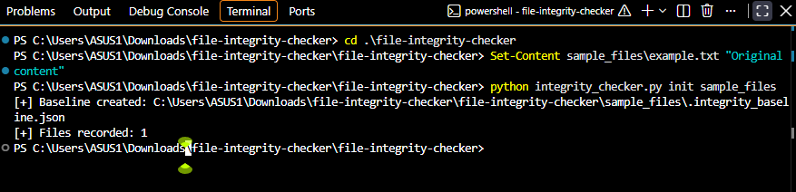
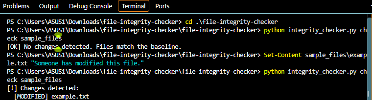

# 🔐 File Integrity Checker

A Python-based cybersecurity tool that monitors files and directories for unauthorized changes using **SHA-256 cryptographic hashing**.

This project demonstrates a basic File Integrity Monitoring (FIM) approach by creating a trusted hash baseline and comparing it against the current state of monitored files.

## 🚀 Features

* **File Modification Detection:** Identifies files whose contents have changed.
* **New File Detection:** Identifies newly added files.
* **File Deletion Detection:** Identifies files removed after baseline creation.
* **SHA-256 Hashing:** Uses cryptographic hashing to verify file integrity.
* **JSON Baseline Storage:** Stores file hashes in a JSON baseline.
* **Command-Line Interface:** Provides simple commands for initialization and verification.

## 🛠️ Technologies Used

* Python 3.8+
* SHA-256
* JSON
* pathlib
* argparse

No third-party Python packages are required.

## ⚙️ How It Works

1. Run the `init` command to calculate SHA-256 hashes for files in a directory.
2. The calculated hashes are saved in `.integrity_baseline.json`.
3. Run the `check` command to compare current file hashes with the saved baseline.
4. The program reports newly added, deleted, and modified files.

## 📥 Installation

Clone the repository:

```bash
git clone https://github.com/Vinusha-03/file-integrity-checker.git
cd file-integrity-checker
```

Make sure Python 3.8 or later is installed.

## ▶️ Usage

**1. Create a folder to monitor**

```bash
mkdir sample_files
echo "Original content" > sample_files/example.txt
```

**2. Create the initial integrity baseline**

```bash
python integrity_checker.py init sample_files
```

**3. Check file integrity**

```bash
python integrity_checker.py check sample_files
```

**4. Modify a file and check again**

```bash
echo "This file was changed" >> sample_files/example.txt
python integrity_checker.py check sample_files
```

You can also try adding or deleting files and running the check command again.

## 📸 Example Output

**Baseline creation:**

```text
[+] Baseline created: sample_files/.integrity_baseline.json
[+] Files recorded: 1
```

**Modified file detection:**

```text
[!] Changes detected:
  [MODIFIED] example.txt
```

## 📂 Project Structure

```text
file-integrity-checker/
│
├── integrity_checker.py
├── README.md
└── .gitignore
```

## 📚 Concepts Learned

* Cryptographic hashing using SHA-256
* File handling with pathlib
* Detecting file changes through hash comparison
* JSON data storage
* Command-line argument handling with argparse
* Basic cybersecurity monitoring

## 🔒 Security Considerations

The baseline file must be protected. If an attacker can modify both the monitored files and the baseline, they may be able to hide changes.

For stronger protection, store or sign the baseline separately and keep it somewhere the monitored user cannot modify.

This is an educational project and is not a replacement for a professional File Integrity Monitoring (FIM) system.

## 👩‍💻 Author

**Vinusha Dmello**

Computer Science Engineer | Python | Cybersecurity | Software Development

[GitHub Profile](https://github.com/Vinusha-03)

## 📄 License

This project is licensed under the MIT License.
## 📸 Screenshots

### Baseline Creation


### Modified File Detection


